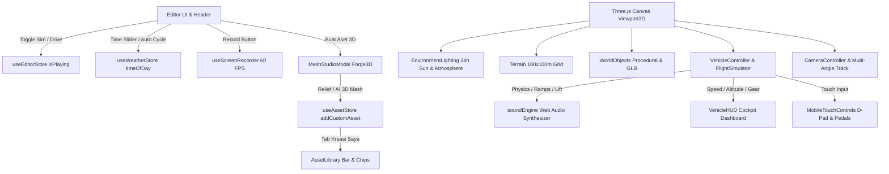

# TASK PLAN: ADOPSI FITUR LENGKAP BANGPAY SIMULATOR KE AUDIRA 3D

> Dokumen Rencana Kerja Teknis & Tata Kelola Permanen Sesuai Standar `AGENTS.md` & `.agents/`.  
> **Status:** Active Execution  
> **Target:** Mengintegrasikan seluruh 7 fitur unggulan dari BangPay Simulator & BangPay Mesh ke dalam Audira 3D Simulator secara modular tanpa merusak fitur eksis.  
> **Last Updated:** 2026-10-02  

---

## 0. Prerequisite & Aturan Mandatori (.agents Rules)

Sesuai dengan `AGENTS.md` dan `.agents/ARCHITECTURE.md`:
1. **100% WebGL / Browser-Based 3D**: Menggunakan Three.js, React Three Fiber (R3F), React 19, TypeScript strict mode, dan Vite 6. Dilarang menggunakan engine binary eksternal (Unity/Godot/Unreal).
2. **Preservasi Fitur Eksis**: Sistem penempatan objek raycasting, TransformControls (Translate/Rotate/Scale), undo/redo snapshot (30 langkah), properties panel, dan penyimpanan proyek JSON/LocalStorage tetap aktif dan tidak boleh terganggu.
3. **Modular Zustand Stores**: Setiap domain logic dipisahkan ke dalam store masing-masing:
   - `useWorldStore`: Data objek spasial 3D (`GameObject[]`), snapshot undo/redo, status proyek.
   - `useEditorStore`: Mode transform, active tool, simulator state (`isPlaying`, `simSpeed`, `simVehicleName`), studio modal.
   - `useAssetStore`: Katalog asset, pencarian nama, filter sub-kategori, asset kustom (`addCustomAsset`).
   - `useWeatherStore`: Kontrol waktu 24 jam (`timeOfDay`), tipe cuaca, siklus matahari otomatis (`autoCycle`).
   - `useHistoryStore`: Manajemen tumpukan riwayat mutasi dunia.
4. **Desain UI Dark Modern**: Mempertahankan palette glassmorphism modern, aksen cyan/blue `#00d2ff`, dark charcoal `#060b10` & `#091118`, dan layout profesional (Header atas, 3D Canvas tengah, Properties kanan, Asset Library bawah).

---

## 1. Arsitektur Integrasi & Data Flow

---

## 2. Rincian 7 Fitur Utama & Status Implementasi

### 🚀 Fitur 1: Sistem Kamera Multi-Sudut & Sudut Pandang Kokpit (Cockpit View)
- **File**: [`apps/web/src/features/vehicles/VehicleSimulator.tsx`](file:///f:/AUDIRA-3D-SIMULATOR/apps/web/src/features/vehicles/VehicleSimulator.tsx)
- **Spesifikasi**:
  - 4 mode kamera yang dapat diganti dengan tombol shortcut `C` atau tombol HUD:
    1. **Follow / Chase Camera**: Mengikuti bagian belakang kendaraan dengan redaman suspensi halus (*lerp*).
    2. **Cockpit View**: Berada tepat di kabin pengemudi / kokpit pesawat menghadap kaca depan.
    3. **Cinematic Track**: Kamera statis di sisi lintasan yang melacak gerakan kendaraan secara dramatis.
    4. **Drone / Top-Down**: Kamera udara dari atas dengan pandangan luas.
  - HUD menampilkan indikator kamera aktif (`FOLLOW`, `COCKPIT`, `CINEMATIC`, `DRONE`).

### ✈️ Fitur 2: Simulasi Penerbangan Pesawat (Flight Simulator & Aerodynamics)
- **File**: [`apps/web/src/features/vehicles/VehicleSimulator.tsx`](file:///f:/AUDIRA-3D-SIMULATOR/apps/web/src/features/vehicles/VehicleSimulator.tsx)
- **Spesifikasi**:
  - Diterapkan otomatis saat kendaraan kategori `'pesawat'` (`airport-airplane`, `light-aircraft`, atau pesawat kustom) dipilih.
  - Aerodinamika: Kecepatan maju (*forward speed*) menghasilkan gaya angkat (*lift*).
  - Kontrol kemudi 3D:
    - `W`/`S`: Throttle mesin jet & dorongan baling-baling.
    - `Space` / `E`: Elevator Pitch Up (Naik ke langit).
    - `Shift` / `Q`: Elevator Pitch Down (Menukik turun).
    - `A`/`D`: Roll & Yaw belok kiri/kanan.
  - Dashboard HUD Kokpit: Menampilkan **Kecepatan Udara (km/h)** dan **Altimeter Ketinggian (m)**.

### 📹 Fitur 3: Perekam Video Layar Game Bawaan 60 FPS (MediaRecorder)
- **File**: [`apps/web/src/features/recording/useScreenRecorder.ts`](file:///f:/AUDIRA-3D-SIMULATOR/apps/web/src/features/recording/useScreenRecorder.ts) & [`Header.tsx`](file:///f:/AUDIRA-3D-SIMULATOR/apps/web/src/components/layout/Header.tsx)
- **Spesifikasi**:
  - Mengambil frame WebGL langsung via `canvas.captureStream(60)`.
  - Menggabungkan Web Audio stream dari `soundEngine` ke dalam media stream video.
  - Tombol **`REC`** di Header dengan animasi detak merah (*pulsing red dot*) dan penghitung waktu durasi (`REC 00:15`).
  - Output langsung diunduh otomatis dalam format `.webm` resolusi penuh 6 Mbps saat tombol distop.

### ☀️ Fitur 4: Siklus Waktu 24 Jam & Cuaca Dinamis (Day/Night & Lighting)
- **File**: [`apps/web/src/stores/useWeatherStore.ts`](file:///f:/AUDIRA-3D-SIMULATOR/apps/web/src/stores/useWeatherStore.ts) & [`EnvironmentLighting.tsx`](file:///f:/AUDIRA-3D-SIMULATOR/apps/web/src/features/world/EnvironmentLighting.tsx)
- **Spesifikasi**:
  - Slider waktu 0.0 - 24.0 jam di Header dan tab **LANSKAP**.
  - Posisi matahari dihitung secara sferis `(x = cos(θ), y = sin(θ), z = sin(θ)*0.4)`.
  - Suhu warna cahaya (*color temperature*):
    - 06:00 (Pagi): Fajar keemasan lembut (#ffe6b0).
    - 12:00 (Siang): Matahari terik putih terang (#ffffff, intensitas 2.2).
    - 17:30 (Sore): Golden hour oranye senja (#ff7733).
    - 20:00 - 05:00 (Malam): Langit malam gelap (#050b14), kabut malam, dan pencahayaan bulan perak lembut.
  - Fitur `autoCycle` untuk rotasi waktu otomatis siang-malam secara terus-menerus.

### 🏎️ Fitur 5: Fisika Lompatan Stunt Ramp (Ramp Launching & Airborne Suspension)
- **File**: [`apps/web/src/features/vehicles/VehicleSimulator.tsx`](file:///f:/AUDIRA-3D-SIMULATOR/apps/web/src/features/vehicles/VehicleSimulator.tsx)
- **Spesifikasi**:
  - Deteksi objek tanjakan akrobatik (`football-ramp`, `road-wooden-ramp`, `road-industrial-ramp`, `road-stunt`).
  - Saat melaju di atas tanjakan, kecepatan maju ditransformasi menjadi gaya angkat vertikal ($v_y$) dan rotasi pitch bodi mobil.
  - Gravitasi $g = 25 \, m/s^2$ menarik mobil kembali ke tanah secara realistis.
  - Efek suara suspensi & benturan saat pendaratan (*impact sound*).

### 📱 Fitur 6: Virtual Joystick & Tombol Sentuh Mobile (Mobile & Tablet Friendly)
- **File**: [`apps/web/src/features/vehicles/MobileTouchControls.tsx`](file:///f:/AUDIRA-3D-SIMULATOR/apps/web/src/features/vehicles/MobileTouchControls.tsx)
- **Spesifikasi**:
  - Deteksi otomatis layar sentuh (`window.matchMedia('(pointer: coarse)')`).
  - D-Pad tombol belok kiri/kanan di sudut kiri bawah layar.
  - Pedal analog besar di kanan bawah:
    - **Pedal Gas (Hijau)**: Throttle akselerasi.
    - **Pedal Rem (Merah)**: Pengereman dan mundur.
    - **Tombol Klakson (Kuning)**: Membunyikan klakson.
    - **Tombol Kamera (Cyan)**: Mengganti sudut pandang kamera (Chase/Cockpit).

### 🎨 Fitur 7: AI 3D Mesh Studio (Depth Slider, Cutout, & Galeri)
- **File**: [`apps/web/src/features/studio/MeshStudioModal.tsx`](file:///f:/AUDIRA-3D-SIMULATOR/apps/web/src/features/studio/MeshStudioModal.tsx)
- **Spesifikasi**:
  - UI Studio menyerupai Forge3D / BangPay Mesh V_1.
  - Dropzone gambar atau pilih dari template preset (Mobil GT, Pinus, Kastil, Robot, Batu).
  - Mode Pembuatan:
    1. **Relief Cepat (Klien Lokal)**: 100% instan, tanpa server, menghasilkan mesh volumetrik 3D dari gambar dengan UV mapping dan side walls.
    2. **AI 3D Penuh (ZeroGPU Trellis / TripoSG)**: Menghasilkan model mesh 3D manifold penuh via Hugging Face API.
  - Kontrol Shading: Tampilan Foto Bertekstur vs Resin Tanah Liat Stylized, toggle wireframe, dan auto-turntable.
  - Ekspor berkas `.glb` langsung ke hard drive.
  - Tombol **"Tambahkan ke Simulator"**: Memasukkan objek baru langsung ke tab **KREASI SAYA** dan menaruhnya di dunia 3D.

---

## 3. Checklist Verifikasi & Jaminan Mutu

- [x] **Kompilasi TypeScript:** `pnpm build` menghasilkan bundle tanpa error (exit code 0).
- [x] **Struktur Monorepo:** Tipe shared di `packages/shared`, game core di `packages/game-core`, UI di `apps/web`.
- [x] **Zero 404 Missing Asset:** Seluruh 52 model GLB dan prosedural terdaftar di katalog dengan kategori rapi (Peta, Kendaraan, Pesawat, Tractor, Dekorasi, Objek, Lanskap, Kreasi Saya).
- [x] **Preservasi Editor Spasial:** TransformControls, Grid 1m Snapping, Undo/Redo, dan JSON Save/Load berfungsi normal.
- [x] **Multi-Platform Responsif:** Mendukung kontrol keyboard mouse di Desktop serta tombol sentuh virtual di perangkat mobile.
